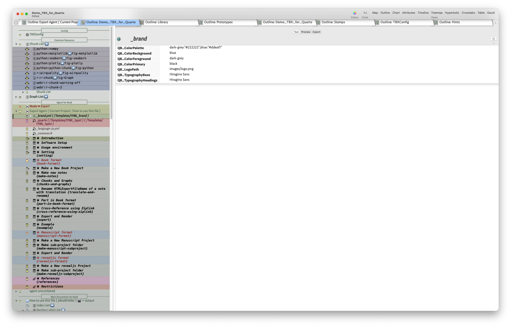
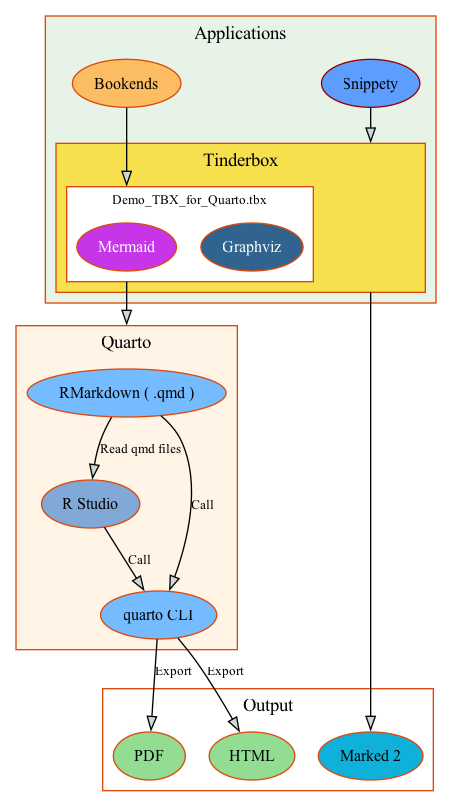
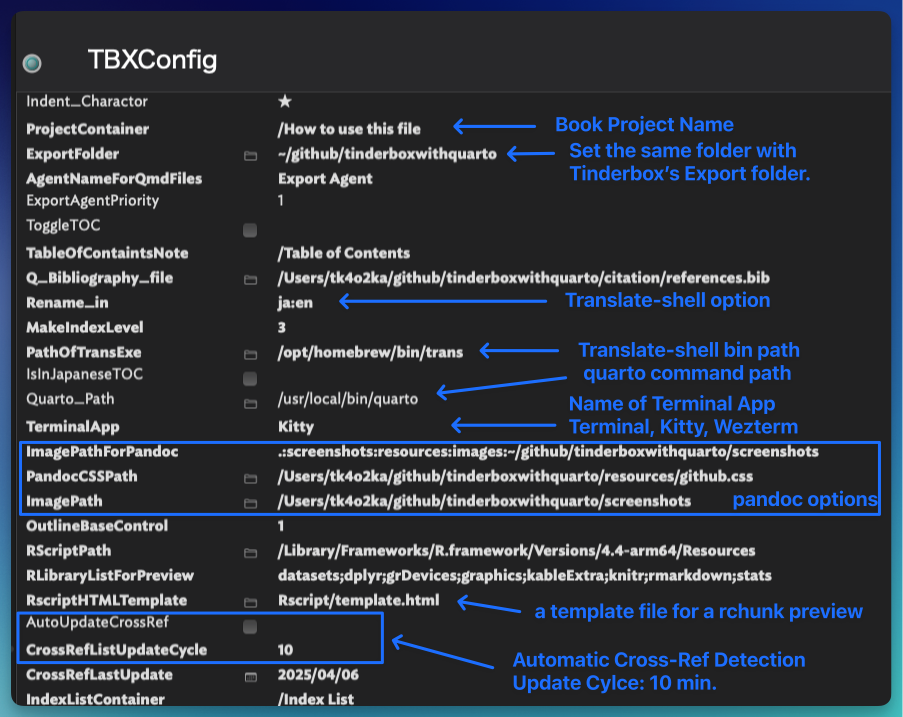
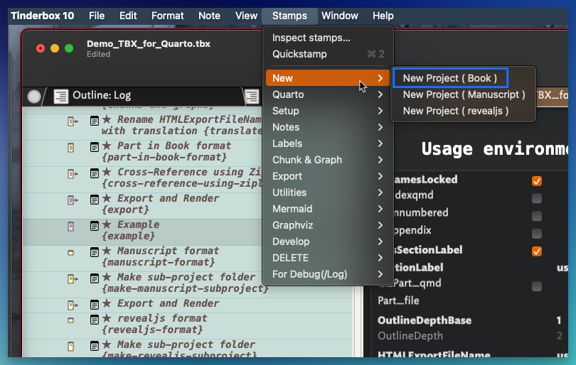
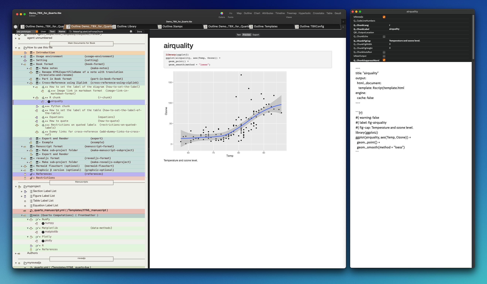
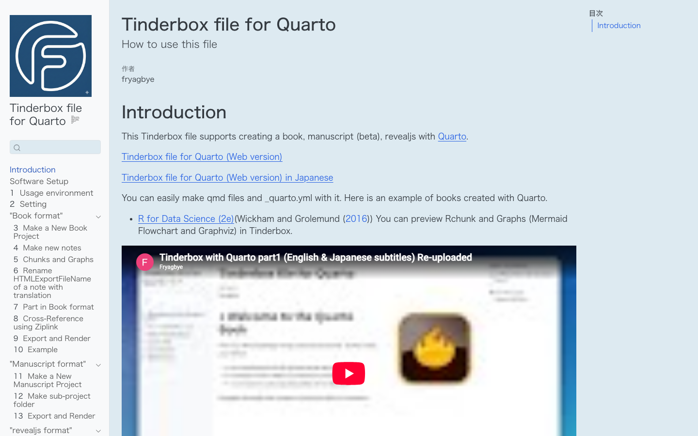
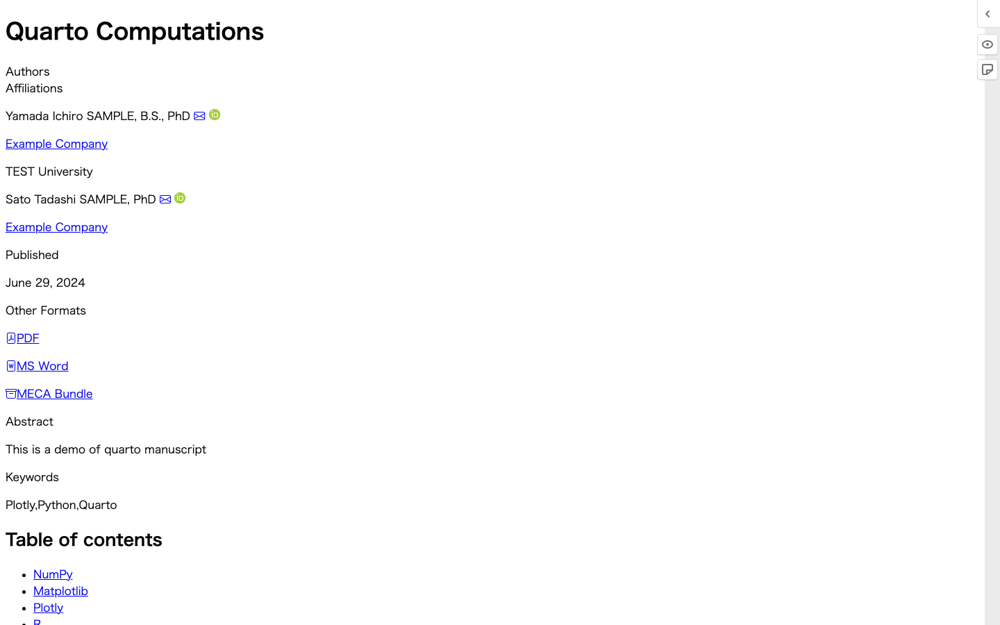

# Tinderbox with Quarto

Tinderbox をエディタ・情報管理ツールとして使い、[Quarto](https://quarto.org/) プロジェクト（`.qmd` / `_quarto.yml`）を生成するワークフロー。
Use Tinderbox as an authoring front end that generates Quarto projects (`.qmd` / `_quarto.yml`).

**[日本語](#日本語) | [English](#english)**

Demo:

- [Tinderbox file for Quarto (Web)](https://fryagbye.quarto.pub/tinderbox-file-for-quarto/)
- [Tinderbox file for Quarto (Web) in Japanese](https://fryagbye.quarto.pub/tinderbox-file-for-quarto-in-japanese)
- [live-revealjs example](https://fryagbye.quarto.pub/quarto-presentations/#/title-slide)
- [YouTube tutorial](https://youtu.be/4BEroHg-F8Y)



---

<a id="日本語"></a>
# 日本語

## 概要

[Tinderbox](https://www.eastgate.com/Tinderbox/) はアウトライン・マップ・属性・ActionCode などを備えた macOS 向けノートツールです。このリポジトリの Tinderbox ファイル（`Demo_TBX_for_Quarto.tbx` / `TinderboxWithQuarto-x.y.z.tbx`）は、ノートの内容を Quarto の `.qmd` ファイルと `_quarto.yml` にエクスポートし、book・manuscript・revealjs の各プロジェクトを生成します。

主な機能:

- Quarto **book**（HTML / PDF / Typst）、**manuscript**（HTML / DOCX / JATS / MECA）、**revealjs** スライドの生成
- R chunk・Python chunk・Mermaid・Graphviz の **Tinderbox 内レンダリングプレビュー**
- Ziplink を使った Quarto 相互参照（`@fig-` / `@tbl-` / `@eq-` / `@sec-`）の入力支援とラベル一覧の自動収集
- 引用（`citation/references.bib` + citeproc）、`_brand.yml`、`_language.yml` による日本語化・ブランド設定
- 日本語タイトルの自動翻訳で `HTMLExportFileName` を生成（translate-shell / plamo-translate、任意）



## プロジェクトの全体像

```text
Tinderbox (.tbx)
  ├─ ノート（pNote / pSubnote …プロトタイプで Markdown 構造を制御）
  ├─ Export Agent ──export──> output/  (.qmd, _quarto.yml, _brand.yml …)
  └─ Preview モード ──pandoc / Rscript──> Tinderbox 内プレビュー
                                    │
quarto preview / quarto render ─────┘
  ├─ HTML book        (output/_bookhtml/)
  ├─ PDF / Typst      (output/_bookpdf/, output/_booktypst/)
  ├─ Manuscript       (myproject/_manuscript/ …HTML/DOCX/JATS)
  └─ revealjs         (myrevealjs*/ …)
```

主要ディレクトリ:

| パス | 内容 |
|---|---|
| `Demo_TBX_for_Quarto.tbx` | 開発用メインファイル |
| `TinderboxWithQuarto-*.tbx` | 配布用ファイル |
| `output/` | book プロジェクトのエクスポート先・レンダリング結果 |
| `myproject/` | manuscript プロジェクト例 |
| `myrevealjs/` `myrevealjs2/` | revealjs プロジェクト例 |
| `Templates/` `Hints/` | エクスポートテンプレート・ライブラリ |
| `citation/references.bib` | 参考文献データベース |
| `pyproject.toml` / `uv.lock` | Python 依存関係（uv 管理） |
| `renv.lock` / `renv/` | R パッケージ（renv 管理） |

## 必要なソフトウェア

| ソフトウェア | 用途 | 必須 | 公式サイト |
|---|---|---|---|
| Tinderbox 11.8+ | ノート編集・エクスポート（macOS のみ） | ✔ | [Eastgate](https://www.eastgate.com/Tinderbox/) |
| Quarto 1.8+ | `.qmd` → 各フォーマットへのレンダリング | ✔ | [quarto.org](https://quarto.org/docs/getting-started/installation.html) |
| R 4.5+ | R chunk の実行・プレビュー（renv） | ✔ | [CRAN](https://cran.r-project.org/) |
| Python 3.12+ + uv | Python chunk 実行（`.venv`） | ✔ | [astral.sh/uv](https://docs.astral.sh/uv/) |
| Git | リポジトリのクローン | ✔ | [git-scm.com](https://git-scm.com/downloads) |
| MacTeX（lualatex） | 日本語 PDF 出力（`$Q_PDFEngine = lualatex`） | PDF のみ | [tug.org/mactex](https://tug.org/mactex/) |
| Google Chrome | `quarto check` のヘッドレス確認・プレビュー | 推奨 | — |
| RStudio Desktop | `.qmd` の編集・レンダリング | 任意 | [posit.co](https://posit.co/download/rstudio-desktop/) |
| translate-shell / plamo-translate | `HTMLExportFileName` の自動翻訳 | 任意 | [translate-shell](https://github.com/soimort/translate-shell) |

## 環境構築

### 1. リポジトリのクローン

```bash
git clone https://github.com/fryagbye/tinderboxwithquarto.git
cd tinderboxwithquarto
```

### 2. Quarto

```bash
brew install quarto
# または https://quarto.org/docs/getting-started/installation.html のインストーラ
```

### 3. Python（uv）

依存関係は `uv.lock` で固定されています。

```bash
brew install uv        # 未インストールの場合
uv sync                # .venv を作成し依存パッケージをインストール
```

matplotlib / plotly / pandas / jupyter / kaleido / ipykernel 等が `.venv` に入ります。スタンプから Quarto コマンドを呼ぶ場合は `$VenvActivateCommand`（既定: `source .venv/bin/activate`）で仮想環境が有効化されます。

### 4. R + パッケージ（renv）

R を [CRAN](https://cran.r-project.org/) からインストール後、プロジェクトルートで:

```r
# R コンソールで実行（renv が未インストールなら先に install.packages("renv")）
renv::restore()
```

`renv.lock` に記録された全パッケージがプロジェクトローカルに復元されます。プレビューで使用するライブラリは TBXConfig の `$RLibraryListForPreview` で宣言されています（既定: `dplyr; knitr; kableExtra; stats; datasets; graphics; grDevices; rmarkdown`。デモの chunk ではさらに `ggplot2` 等を使用）。

### 5. MacTeX（日本語 PDF を出力する場合）

```bash
brew install --cask mactex
```

TinyTeX では日本語 PDF に必要な lualatex 環境が不足するため MacTeX を推奨します。

### 6. 動作確認

```bash
quarto check
```

### 7. Tinderbox で開く

`Demo_TBX_for_Quarto.tbx`（または配布用 `TinderboxWithQuarto-x.y.z.tbx`）を Tinderbox 11.8+ で開き、次の `TBXConfig` 設定を行います。

## TBXConfig の設定

ドキュメント内の **TBXConfig** ノートで環境に合わせて属性を設定します。



| 属性 | 説明 |
|---|---|
| `$ExportFolder` | エクスポート先。**絶対パス**を指定（例: `/Users/you/github/tinderboxwithquarto`）。クォートされたコマンド内では `~` が展開されません |
| `$ProjectContainer` | 相互参照検索対象のプロジェクトコンテナ（例: `/How to use this file`） |
| `$Quarto_Path` | quarto コマンドのパス（例: `/usr/local/bin/quarto`） |
| `$TerminalApp` | スタンプ実行に使うターミナルアプリ名 |
| `$RScriptPath` `$RLibraryListForPreview` `$RscriptHTMLTemplate` | R chunk プレビュー用 |
| `$ImagePathForPandoc` `$PandocCSSPath` `$ImagePath` | プレビューの pandoc `--resource-path` / `--css` |
| `$Q_BibliographyFile` | 参考文献 `.bib` のパス（プロジェクトコンテナ側でも設定可） |
| `$Q_PDFEngine` | PDF エンジン（既定: `lualatex`） |
| `$Rename_in` / `$PathOfTranslationCli` | 自動翻訳（既定 `ja:en`、translate-shell / plamo-translate、任意） |
| `$ToggleTOC` `$TableOfContaintsNote` `$MakeIndexLevel` | TOC / 目次関連 |

`_quarto.yml` の内容は `_quarto` ノートの `Q_*` 属性から生成されます（例: `$Q_Title`, `$Q_Author`, `$Q_HtmlTheme`）。日本語化する場合は `_language` ノート（`_language.yml`）をエクスポートし `$Q_HasLanguageYml = true`。

## 使い方

### 1. プロジェクト作成（スタンプ）

- `New: New Project ( Book )` — book プロジェクト（1ファイルに1つ）
- `New: New Project ( Manuscript )` — manuscript プロジェクト（複数可）
- `New: New Project ( revealjs )` — revealjs プロジェクト（複数可）



### 2. ノートを書く

- タイトルの末尾に `#pNote` / `#pSubnote` を付ける（またはプロトタイプを適用）。`pNote` = セクション、`pSubnote` = サブセクション。階層に応じて見出しレベルが自動調整されます
- `index.qmd` は `pIndexQmd` プロトタイプまたは `$IsIndexqmd = true`
- book では `pNote` の入れ子が Quarto の **Part / Chapter** に対応します

### 3. chunk・グラフ・相互参照

- `pRChunk` / `pPChunk` ノートにコードを書き、`Chunk & Graph: Make Chunk and Graph List` スタンプで `＜r:tag➡️fig-label＞` 形式のタグを生成
- ラベルは `#| label: fig-xxx` 形式で記述（`{r fig-xxx}` 形式は非対応）
- 相互参照は Ziplink（`[[` 入力）で `@fig-` / `@tbl-` / `@eq-` / `@sec-` ラベルを挿入
- Preview モード（`Notes: Set Preview Mode`）で R/Python chunk・Mermaid・Graphviz の結果を Tinderbox 内で確認できます



### 4. エクスポートとレンダリング

1. `_quarto` ノートをエクスポート → `output/_quarto.yml`
2. Export Agent 配下の `pNote` をエクスポート → `output/*.qmd`
3. ターミナルまたはスタンプでレンダリング:

```bash
quarto preview output     # HTML プレビュー
quarto render output      # book（html / pdf / typst）
quarto render myproject   # manuscript
```

`Quarto: Book Preview` / `Quarto: Book Render` スタンプからも実行できます。





## 既知の注意点

- **パスは絶対パスで**: シェルコマンドに渡すパスはクォートされるため `~` は展開されません。`$ExportFolder`・`$Q_BibliographyFile` 等は `/Users/you/...` 形式で設定してください
- **Pandoc `--mathjax` 警告**: rmarkdown（≤2.32）が pandoc 3.11+ に非推奨の `--mathjax` を渡す警告が出ます。R chunk プレビューコマンド側でフィルタ済みです
- **whitespace-only 行**: エクスポートテンプレート内の空白行は Quarto 出力での段落区切り維持のため意図的です
- **`$IsUnnumbered` + `$HasSectionLabel`**: セクションラベルカスタマイズに既知の制約あり（[quarto-cli#5946](https://github.com/quarto-dev/quarto-cli/issues/5946)）
- **Python プレビュー**: Pyodide ベースのため、Pyodide 非対応ライブラリ（plotly 等）はエラーになります

## ライセンス

MIT

---

<a id="english"></a>
# English

## Overview

[Tinderbox](https://www.eastgate.com/Tinderbox/) is a macOS note-taking tool with outlines, maps, attributes, and ActionCode. The Tinderbox files in this repository (`Demo_TBX_for_Quarto.tbx` / `TinderboxWithQuarto-x.y.z.tbx`) export notes into Quarto `.qmd` files and `_quarto.yml`, generating book, manuscript, and revealjs projects.

Key features:

- Generate Quarto **book** (HTML / PDF / Typst), **manuscript** (HTML / DOCX / JATS / MECA), and **revealjs** slides
- **In-Tinderbox rendered preview** of R chunks, Python chunks, Mermaid diagrams, and Graphviz graphs
- Ziplink-assisted Quarto cross-references (`@fig-` / `@tbl-` / `@eq-` / `@sec-`) with automatic label collection
- Citations (`citation/references.bib` + citeproc), `_brand.yml`, and `_language.yml` localization
- Automatic `HTMLExportFileName` translation of Japanese titles (translate-shell / plamo-translate, optional)

## Project structure

```text
Tinderbox (.tbx)
  ├─ Notes (pNote / pSubnote … prototypes control Markdown structure)
  ├─ Export Agent ──export──> output/  (.qmd, _quarto.yml, _brand.yml …)
  └─ Preview mode ──pandoc / Rscript──> in-Tinderbox preview
                                    │
quarto preview / quarto render ─────┘
  ├─ HTML book        (output/_bookhtml/)
  ├─ PDF / Typst      (output/_bookpdf/, output/_booktypst/)
  ├─ Manuscript       (myproject/_manuscript/ …HTML/DOCX/JATS)
  └─ revealjs         (myrevealjs*/ …)
```

| Path | Contents |
|---|---|
| `Demo_TBX_for_Quarto.tbx` | Main development file |
| `TinderboxWithQuarto-*.tbx` | Distributable file |
| `output/` | Book export destination & rendered results |
| `myproject/` | Manuscript project example |
| `myrevealjs/` `myrevealjs2/` | revealjs project examples |
| `Templates/` `Hints/` | Export templates & library |
| `citation/references.bib` | Bibliography database |
| `pyproject.toml` / `uv.lock` | Python dependencies (uv) |
| `renv.lock` / `renv/` | R packages (renv) |

## Requirements

| Software | Purpose | Required | Official site |
|---|---|---|---|
| Tinderbox 11.8+ | Note editing & export (macOS only) | ✔ | [Eastgate](https://www.eastgate.com/Tinderbox/) |
| Quarto 1.8+ | Renders `.qmd` to all formats | ✔ | [quarto.org](https://quarto.org/docs/getting-started/installation.html) |
| R 4.5+ | R chunk execution & preview (renv) | ✔ | [CRAN](https://cran.r-project.org/) |
| Python 3.12+ + uv | Python chunks (`.venv`) | ✔ | [astral.sh/uv](https://docs.astral.sh/uv/) |
| Git | Clone the repository | ✔ | [git-scm.com](https://git-scm.com/downloads) |
| MacTeX (lualatex) | Japanese PDF output (`$Q_PDFEngine = lualatex`) | PDF only | [tug.org/mactex](https://tug.org/mactex/) |
| Google Chrome | `quarto check` headless check / preview | Recommended | — |
| RStudio Desktop | `.qmd` editing & rendering | Optional | [posit.co](https://posit.co/download/rstudio-desktop/) |
| translate-shell / plamo-translate | `HTMLExportFileName` auto-translation | Optional | [translate-shell](https://github.com/soimort/translate-shell) |

## Setup

### 1. Clone

```bash
git clone https://github.com/fryagbye/tinderboxwithquarto.git
cd tinderboxwithquarto
```

### 2. Quarto

```bash
brew install quarto
# or use the installer from https://quarto.org/docs/getting-started/installation.html
```

### 3. Python (uv)

Dependencies are pinned in `uv.lock`.

```bash
brew install uv        # if not installed
uv sync                # creates .venv and installs dependencies
```

matplotlib / plotly / pandas / jupyter / kaleido / ipykernel etc. are installed into `.venv`. Stamps that call Quarto activate the virtualenv via `$VenvActivateCommand` (default: `source .venv/bin/activate`).

### 4. R + packages (renv)

After installing R from [CRAN](https://cran.r-project.org/), run in the project root:

```r
# in an R console (install renv first if needed: install.packages("renv"))
renv::restore()
```

All packages recorded in `renv.lock` are restored project-locally. Libraries used by the in-Tinderbox preview are declared in `$RLibraryListForPreview` (default: `dplyr; knitr; kableExtra; stats; datasets; graphics; grDevices; rmarkdown`; demo chunks also use `ggplot2` etc.).

### 5. MacTeX (for Japanese PDF)

```bash
brew install --cask mactex
```

MacTeX is recommended because TinyTeX lacks the lualatex setup needed for Japanese PDF.

### 6. Verify

```bash
quarto check
```

### 7. Open in Tinderbox

Open `Demo_TBX_for_Quarto.tbx` (or the distributable `TinderboxWithQuarto-x.y.z.tbx`) in Tinderbox 11.8+ and configure `TBXConfig` as below.

## TBXConfig settings

Configure attributes on the **TBXConfig** note for your environment.

| Attribute | Description |
|---|---|
| `$ExportFolder` | Export destination — use an **absolute path** (e.g. `/Users/you/github/tinderboxwithquarto`); `~` is not expanded inside quoted commands |
| `$ProjectContainer` | Project container for cross-reference search (e.g. `/How to use this file`) |
| `$Quarto_Path` | Path to quarto (e.g. `/usr/local/bin/quarto`) |
| `$TerminalApp` | Terminal app used by stamps |
| `$RScriptPath` `$RLibraryListForPreview` `$RscriptHTMLTemplate` | R chunk preview settings |
| `$ImagePathForPandoc` `$PandocCSSPath` `$ImagePath` | pandoc `--resource-path` / `--css` for preview |
| `$Q_BibliographyFile` | Path to `.bib` (can also be set on the project container) |
| `$Q_PDFEngine` | PDF engine (default: `lualatex`) |
| `$Rename_in` / `$PathOfTranslationCli` | Auto-translation (default `ja:en`, translate-shell / plamo-translate, optional) |
| `$ToggleTOC` `$TableOfContaintsNote` `$MakeIndexLevel` | TOC / index settings |

`_quarto.yml` is generated from the `Q_*` attributes of the `_quarto` note. For Japanese localization, export the `_language` note (`_language.yml`) and set `$Q_HasLanguageYml = true`.

## Usage

### 1. Create a project (stamps)

- `New: New Project ( Book )` — one book project per file
- `New: New Project ( Manuscript )` — multiple projects allowed
- `New: New Project ( revealjs )` — multiple projects allowed

### 2. Write notes

- Append `#pNote` / `#pSubnote` to the title (or apply the prototype). `pNote` = section, `pSubnote` = subsection; heading levels follow the outline depth
- `index.qmd` via the `pIndexQmd` prototype or `$IsIndexqmd = true`
- In books, nested `pNote` maps to Quarto **Part / Chapter**

### 3. Chunks, graphs, and cross-references

- Write code in `pRChunk` / `pPChunk` notes, then run `Chunk & Graph: Make Chunk and Graph List` to generate `＜r:tag➡️fig-label＞` tags
- Labels use `#| label: fig-xxx` syntax (`{r fig-xxx}` is not supported)
- Cross-references: insert `@fig-` / `@tbl-` / `@eq-` / `@sec-` labels via Ziplink (`[[`)
- Preview mode (`Notes: Set Preview Mode`) renders R/Python chunks, Mermaid, and Graphviz inside Tinderbox

### 4. Export and render

1. Export the `_quarto` note → `output/_quarto.yml`
2. Export `pNote` notes under the Export Agent → `output/*.qmd`
3. Render via terminal or stamps:

```bash
quarto preview output     # HTML preview
quarto render output      # book (html / pdf / typst)
quarto render myproject   # manuscript
```

`Quarto: Book Preview` / `Quarto: Book Render` stamps do the same from Tinderbox.

## Known issues

- **Use absolute paths**: paths passed to shell commands are quoted, so `~` is not expanded. Set `$ExportFolder`, `$Q_BibliographyFile`, etc. as `/Users/you/...`
- **Pandoc `--mathjax` warning**: rmarkdown (≤2.32) passes deprecated `--mathjax` to pandoc 3.11+; the generated preview command filters this warning
- **Whitespace-only lines** in export templates are intentional — they preserve paragraph separation in Quarto output
- **`$IsUnnumbered` + `$HasSectionLabel`**: known limitation ([quarto-cli#5946](https://github.com/quarto-dev/quarto-cli/issues/5946))
- **Python preview** runs on Pyodide; unsupported libraries (e.g. plotly) will error

## License

MIT
